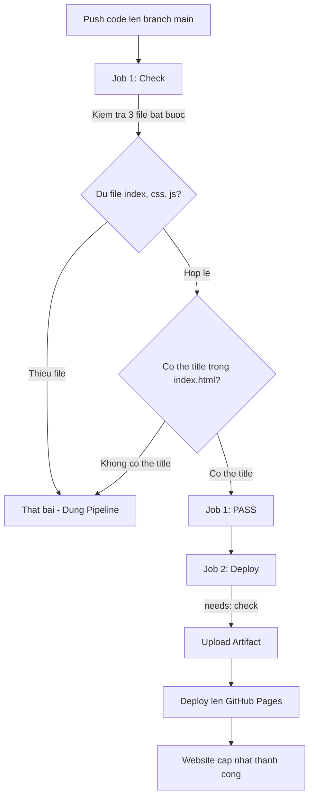

# BÀI TẬP CÁ NHÂN: TRIỂN KHAI WEBSITE TỰ ĐỘNG VỚI GITHUB ACTIONS

## 📌 Thông tin sinh viên
- **Họ và tên:** Lương Nhật Hảo
- **Mã số sinh viên (MSSV):** 1822030132
- **Môn học:** DevOps & Cloud Computing
- **Lớp / Khóa:** 18DTH
- **GitHub Repository:** [devops-1822030132](https://github.com/48HJP/devops-1822030132)
- **Live Website:** [https://48hjp.github.io/devops-1822030132/](https://48hjp.github.io/devops-1822030132/)

---

## 🎯 Mục tiêu bài tập
1. Thực hành quy trình **CI/CD** cơ bản: viết code → push lên GitHub → tự động kiểm tra → tự động deploy.
2. Hiểu rõ vai trò của pipeline trong việc ngăn chặn mã lỗi trước khi triển khai đến tay người dùng.

---

## 🗂️ Cấu trúc thư mục dự án

```text
devops-1822030132/
├── .github/
│   └── workflows/
│       └── deploy.yml      # CI/CD Pipeline với 2 jobs: check và deploy
├── index.html              # Trang chủ hiển thị thông tin sinh viên và MSSV
├── style.css               # Giao diện, màu sắc, hiệu ứng thẻ và button
├── script.js               # Logic JavaScript (hiển thị thời gian, tương tác nút bấm)
├── README.md               # Hướng dẫn và tài liệu dự án
└── push.bat                # Script hỗ trợ push code nhanh lên GitHub
```

---

## ⚙️ Quy trình Pipeline CI/CD (`deploy.yml`)

Pipeline được thiết lập tự động kích hoạt khi có sự kiện **Push** lên nhánh `main`:



### 1. Job `check` (Kiểm tra chất lượng mã nguồn)
- **Kiểm tra 3 file bắt buộc**: Đảm bảo thư mục luôn có đầy đủ `index.html`, `style.css` và `script.js`.
- **Kiểm tra thẻ `<title>`**: Đảm bảo file `index.html` có chứa thẻ tiêu đề hợp lệ để chuẩn SEO và hiển thị tab trình duyệt.

### 2. Job `deploy` (Triển khai lên GitHub Pages)
- Chỉ chạy khi Job `check` thành công (`needs: check`).
- Tự động đóng gói và xuất bản trang web lên **GitHub Pages**.

---

## 🧪 Thực nghiệm Pipeline
- **Thử nghiệm thất bại (Fail):** Cố tình xóa thẻ `<title>` trong `index.html` → push lên GitHub → Pipeline dừng ở Job `check` và báo đỏ ❌.
- **Thử nghiệm thành công (Pass):** Thêm lại thẻ `<title>`, cập nhật nội dung sang `Phiên bản 2.0` → push lên GitHub → Pipeline vượt qua cả 2 Job và website cập nhật trực tiếp ✅.

